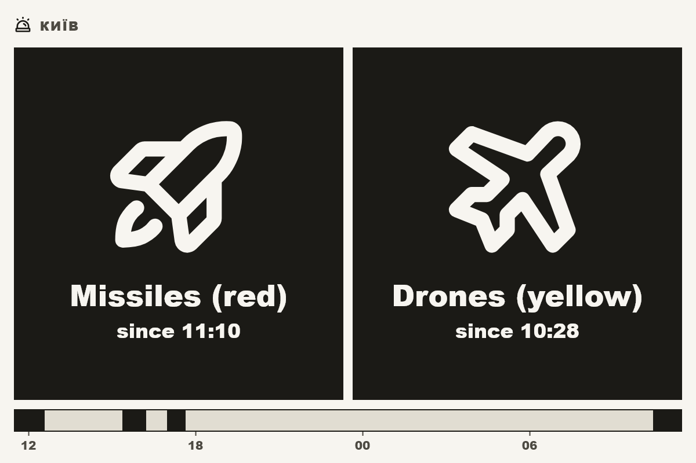
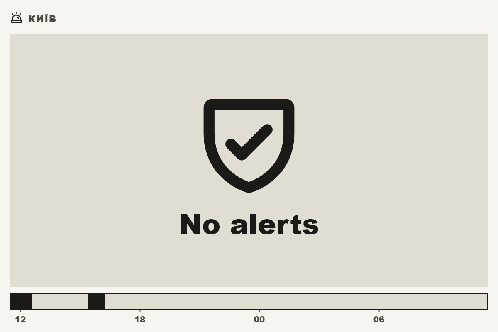

# ha_ukraine_alarm

A Tesserae widget that shows the current air raid and other alerts for one
region of Ukraine, from the Home Assistant
[Ukraine Alarm](https://www.home-assistant.io/integrations/ukraine_alarm/)
integration. Every active alert is a tile with its type and start time; below
them a timeline marks the alert periods of the last hours.

## What it does

- Reads the region's alert sensors and their history through the shared
  Home Assistant Core plugin (`ha_core`); the widget makes no requests of its own.
- Alert types: air raid (with the red and yellow levels when the region
  reports them), artillery, urban fighting, chemical, nuclear, unknown.
- Start times come from the 7-day history, so a Home Assistant restart does
  not reset them.
- Timeline of 6, 12, 24 or 48 hours, or off.
- Sizes `xs`–`lg`; up to three alerts per row, icons scale with the tile.

## Setup

1. Add the **Ukraine Alarm** integration to Home Assistant for your region.
2. Configure the bundled **Home Assistant Core** plugin (Settings → Widgets →
   Home Assistant Core) with your Home Assistant URL and a Long-Lived Access
   Token.
3. Pick the region in the cell options. Regions are found by the integration's
   `binary_sensor` entities; renamed entities are not recognised.

## Cell options

| Option | Values |
| --- | --- |
| Title, Title size | blank = the region name; 0.5–3× |
| Region | a region configured in the Ukraine Alarm integration |
| Hidden alert types | types left out of the tiles and the timeline |
| Timeline | off, 6, 12, 24 hours or 2 days |
| Icons only | tiles without text |

## Locales

English, Russian, Ukrainian.

## Notes

- No `requires` block: all Home Assistant traffic goes through the
  `ha_core` connection, whose host is configured per installation.

## License

AGPL-3.0-or-later, see [LICENSE](LICENSE).
